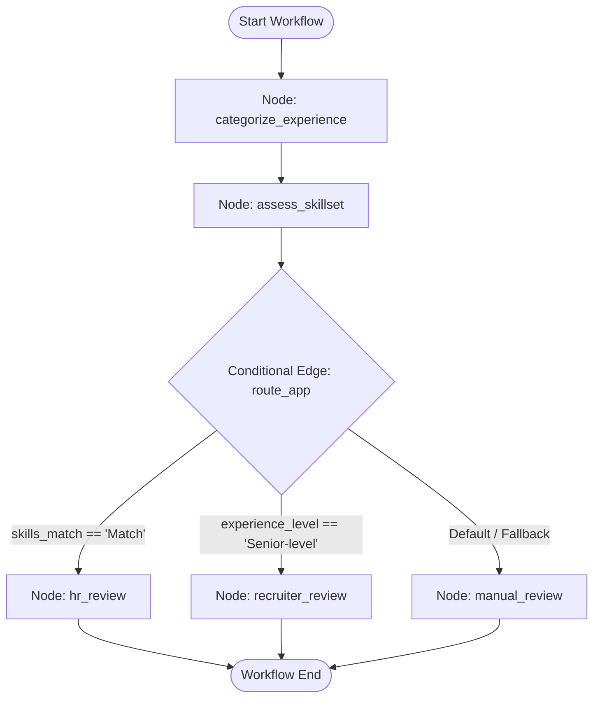

# LangGraph Screening Pipeline Architecture

The core decision-support engine is built using **LangGraph** (`app.workflows.screening`), orchestrating multi-node LLM provider queries, structured output parsing, confidence estimation, and deterministic routing.

---

## Workflow Graph Topology



---

## State Schema (`ScreeningState`)

The graph operates on an immutable-typed state dictionary (`app.workflows.screening.state.ScreeningState`):

```python
class ScreeningState(TypedDict):
    screening_id: str
    application_text: str
    job_title: str
    required_skills: list[str]
    experience_assessment: NotRequired[ExperienceAssessment]
    skills_assessment: NotRequired[SkillsAssessment]
    recommendation: NotRequired[Recommendation]
    recommendation_reason: NotRequired[str]
    human_review_required: NotRequired[bool]
```

---

## Node & Routing Logic Execution Steps

### 1. Node: `categorize_experience`
- Calls `assessor.assess_experience(state["application_text"])` via `OpenAIAssessmentProvider`.
- Extracts structured `ExperienceAssessment`:
  - `level`: `ExperienceLevel` (`Entry-level`, `Mid-level`, `Senior-level`, `Insufficient evidence`)
  - `confidence`: float between `0.0` and `1.0`
  - `evidence`: list of up to 8 verbatim candidate resume quote strings supporting the classification.

### 2. Node: `assess_skillset`
- Calls `assessor.assess_skills(state["application_text"], state["job_title"], state["required_skills"])`.
- Extracts structured `SkillsAssessment`:
  - `match`: `SkillMatch` (`Match`, `Partial match`, `No match`, `Insufficient evidence`)
  - `confidence`: float between `0.0` and `1.0`
  - `evidence`: list of up to 12 verbatim text quote strings.
  - `gaps`: list of required skills missing or unverified in candidate text.

### 3. Conditional Edge: `route_app`
Deterministic routing logic assigns candidate submissions to advisory review queues:

1. **HR Review Queue (`hr_review`):** Selected when `skills_assessment.match == SkillMatch.MATCH`. Sets `recommendation = Recommendation.HR_REVIEW` and `recommendation_reason = "Skills evidence supports prioritizing a human HR review; no hiring decision has been made."`.
2. **Recruiter Review Queue (`recruiter_review`):** Selected when `experience_level == ExperienceLevel.SENIOR` (and skills match is incomplete). Sets `recommendation = Recommendation.RECRUITER_REVIEW` and `recommendation_reason = "Experience appears senior while required-skill evidence is incomplete or not matched; recruiter review is suggested."`.
3. **Manual Review Queue (`manual_review`):** Default fallback when evidence is inconclusive or mismatched. Sets `recommendation = Recommendation.MANUAL_REVIEW` and `recommendation_reason = "Evidence is insufficient or does not clearly support the other review routes; qualified human review is required."`.

*Note: All review routes strictly set `human_review_required = True`.*

---

## Provider Abstraction & Telemetry Callbacks

- **Provider Dependency Injection:** Graph compilation accepts `provider: AssessmentProvider | None`. In unit/offline tests, fake providers can be injected without external API calls.
- **OpenTelemetry LLM Callback Handler (`TelemetryCallbackHandler`):** Attached during production graph execution (`ainvoke`). Records LLM completion token counts, prompt token counts, call latencies, and model versions without exporting applicant resume text to traces.

---

## Related Documents
- [System Architecture Overview](overview.md)
- [PII Redaction Engine Reference](pii-redaction.md)
- [Offline Evaluation Framework](../evaluation/offline-evaluation.md)
