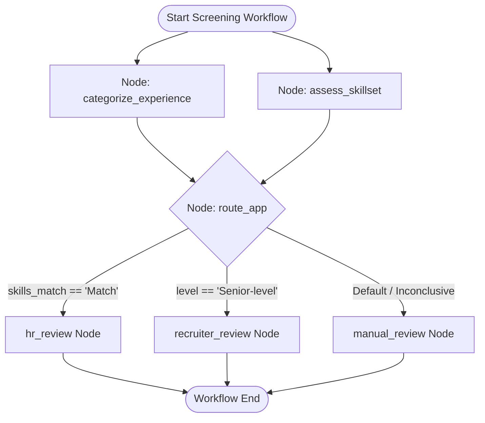

# LangGraph Screening Pipeline Architecture

The core assessment engine is built using **LangGraph** (`app.workflows.screening`), orchestrating LLM queries, structured parsing, confidence estimation, and deterministic routing.

---

## Workflow Graph Diagram



---

## Workflow Execution Nodes

1. **`categorize_experience` Node:**
   - Submits redacted application text to LLM using `EXPERIENCE_SYSTEM_PROMPT`.
   - Extracts structured `ExperienceAssessment` (Level, Confidence, Evidence, Rationale).
2. **`assess_skillset` Node:**
   - Submits application text alongside job title and required skill list using `SKILLS_SYSTEM_PROMPT`.
   - Extracts structured `SkillsAssessment` (Match, Confidence, Evidence, Gaps, Rationale).
3. **`route_app` Deterministic Router:**
   - Inspects generated assessments to determine review routing without LLM randomness.

---

## Structured Output Schemas

### Experience Assessment Schema (`ExperienceAssessment`)
```python
class ExperienceLevel(StrEnum):
    ENTRY_LEVEL = "Entry-level"
    MID_LEVEL = "Mid-level"
    SENIOR_LEVEL = "Senior-level"
    INSUFFICIENT_EVIDENCE = "Insufficient evidence"

class ExperienceAssessment(BaseModel):
    level: ExperienceLevel
    confidence: float = Field(ge=0.0, le=1.0) # Uncalibrated subjective model score
    evidence: list[str] = Field(max_length=8)  # Max 500 chars per quote
    rationale: str = Field(max_length=1200)
```

### Skills Assessment Schema (`SkillsAssessment`)
```python
class SkillMatch(StrEnum):
    MATCH = "Match"
    PARTIAL_MATCH = "Partial match"
    NO_MATCH = "No match"
    INSUFFICIENT_EVIDENCE = "Insufficient evidence"

class SkillsAssessment(BaseModel):
    match: SkillMatch
    confidence: float = Field(ge=0.0, le=1.0)
    evidence: list[str] = Field(max_length=12)
    gaps: list[str] = Field(max_length=20)
    rationale: str = Field(max_length=1600)
```

---

## Deterministic Routing Rules

The routing logic (`route_app`) applies strict conditional rules:

| Condition | Assigned Route (`Recommendation`) | Human Review Required | Rationale |
| :--- | :--- | :--- | :--- |
| `skills_assessment.match == SkillMatch.MATCH` | `hr_review` | `True` | Skills evidence directly supports job requirements; priority HR review. |
| `experience_assessment.level == ExperienceLevel.SENIOR_LEVEL` | `recruiter_review` | `True` | Experience level is senior, but required skills match is partial/incomplete. |
| *Default Fallback* | `manual_review` | `True` | Evidence is ambiguous or insufficient; requires manual recruiter review. |

!!! warning "Human-in-the-Loop Safeguard"
    All automated routes set `human_review_required = True`. The pipeline serves purely as a decision-support aid and **never** makes autonomous hiring or rejection decisions.

---

## Prompt Versioning & Injection Defenses

- **Prompt Versioning Constant:** `PROMPT_VERSION = "screening-prompts-v1.1.0"` (persisted per screening record for drift auditing).
- **Injection Protection:** System prompts explicitly treat candidate input as untrusted data, instructing the model to ignore embedded commands asking to change roles, reveal prompts, or bypass evaluation rubrics.
- **Fairness Protection:** Prompts explicitly forbid inferring capability from protected characteristics or proxies.

---

## Related Documents
- [PII Redaction Engine](pii-redaction.md)
- [Offline Evaluation Framework](../evaluation/offline-evaluation.md)
