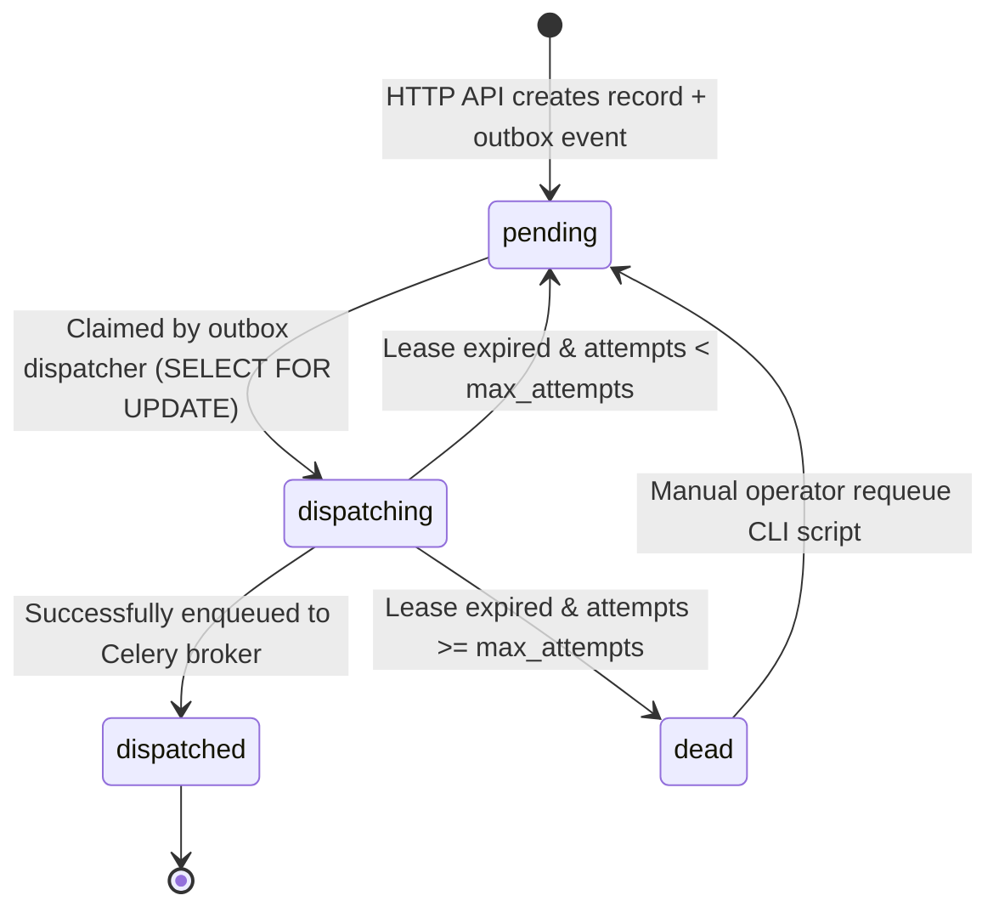

# Outbox & Worker Architecture

To guarantee reliability, the system implements the **Transactional Outbox Pattern** (`app.workers.outbox`), separating HTTP transactions from background task processing.

---

## Outbox Lifecycle & State Transitions



---

## Outbox Dispatch & Lease Mechanics

### 1. Batch Claiming (`_claim_batch`)
- The dispatcher executes every 5 seconds (driven by Celery Beat).
- Fetches up to `OUTBOX_BATCH_SIZE` (default 50) records where `available_at <= NOW()` and `status IN ('pending', 'dispatching')`.
- Uses `with_for_update(skip_locked=True)` to prevent lock contention across multiple dispatcher replicas.

### 2. Lock Leases (`OUTBOX_LEASE_SECONDS`)
- Claimed events are set to `status='dispatching'` with a timestamp `locked_at = NOW()`.
- If a dispatcher worker crashes mid-transit, events locked longer than `OUTBOX_LEASE_SECONDS` (default 120s) are recovered on subsequent passes.

### 3. Retries & Dead-Letter Queue (DLQ)
- Each claim increments `attempt_count`.
- If `attempt_count >= OUTBOX_MAX_ATTEMPTS` (default 12) and the lease expires, the event transitions to `status='dead'` with `last_error_code='dispatch_lease_expired'`.
- Dead-letter events emit metric `outbox.dead`.

---

## Celery Configuration & Idempotent Tasks

```python
celery_app.conf.update(
    task_serializer="json",
    task_acks_late=True,               # Acknowledge only after successful completion
    task_reject_on_worker_lost=True,   # Requeue task if worker process dies unexpectedly
    worker_prefetch_multiplier=1,      # Fair task distribution
    task_time_limit=180,               # Hard timeout (180s)
    task_soft_time_limit=150,          # Soft timeout (150s)
)
```

### Task Redelivery Handling
The worker entrypoint `screen_candidate(screening_id)` inspects message delivery headers. If `redelivered=True`, it enables `allow_reclaim_running=True`, allowing safe execution takeover for stuck or orphaned screening records.

---

## Operator DLQ Requeue Tooling

Dead-letter outbox events can be safely requeued using the operational CLI tool (`app.scripts.requeue_dead_outbox`):

=== "Requeue Single Event"
    ```bash
    python -m app.scripts.requeue_dead_outbox --event-id 123e4567-e89b-12d3-a456-426614174000
    ```

=== "Requeue All Dead Events (Batch)"
    ```bash
    python -m app.scripts.requeue_dead_outbox --all-dead --limit 100
    ```

!!! note "Audit Logging"
    Requeuing dead outbox records automatically emits an `outbox.requeued` audit event into the tenant's hash-chained audit log.

---

## Related Documents
- [System Architecture Overview](overview.md)
- [Operational Runbooks](../observability/runbooks.md)
