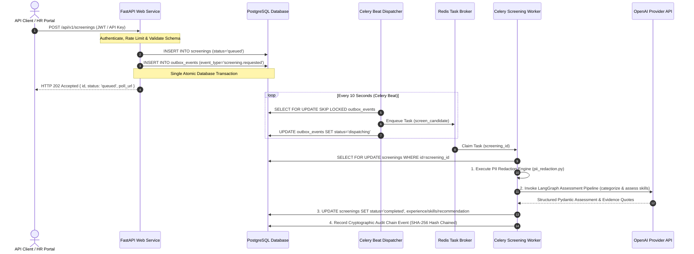

# System Architecture Overview

The **LangGraph Candidate Screening Service** is an enterprise-grade, asynchronous decision-support API built with Python 3.12, FastAPI, PostgreSQL, Redis, Celery, and LangGraph (`app.main`, `app.workflows.screening`, `app.workers`).

---

## Architecture Sequence Diagram

---

## Key System Subsystems

### 1. Async FastAPI Front Door (`app.api.v1`)
- Fast HTTP ingestion layer handling OpenAPI request schema validation, Redis rate-limiting (`enforce_screening_rate_limit`), request fingerprinting, and idempotency deduplication (`Idempotency-Key` header).
- Returns immediate `HTTP 202 Accepted` response with status polling URL (`poll_url`).

### 2. Transactional Outbox Subsystem (`app.workers.outbox`)
- Enforces single database transaction atomicity: screening business records and `OutboxEvent` records commit together.
- Prevents dual-write anomalies (such as database persistence succeeding while task broker publish fails).

### 3. Redis Broker & Celery Worker Nodes (`app.workers`)
- Asynchronous task processing decouples expensive LLM pipeline execution from HTTP web request threads.
- Celery Beat dispatches outbox events every 10 seconds; Celery workers execute background workflows with bounded exponential retries (`TASK_MAX_RETRIES`).

### 4. LangGraph Assessment Workflow Engine (`app.workflows.screening`)
- Multi-node graph orchestration for structured experience categorizing and skill matching.
- Enforces strict Pydantic output validation (`ExperienceAssessment`, `SkillsAssessment`), confidence estimation, evidence quote grounding, and deterministic review queue routing (`hr_review`, `recruiter_review`, `manual_review`).

### 5. Pre-Provider PII Minimization Engine (`app.privacy.pii_redaction`)
- Regex-based pre-provider redaction masks candidate emails, phone numbers, government IDs, and addresses before text is sent to third-party LLMs.
- Preserves raw resume text in the internal PostgreSQL database for human recruiter review.

### 6. Append-Only Tamper-Evident Audit Ledger (`app.audit`)
- Per-tenant SHA-256 cryptographic hash chain tracking all candidate submissions, workflow execution stages, and human reviewer feedback/appeal records.

---

## Related Documents
- [LangGraph Screening Pipeline Architecture](langgraph-pipeline.md)
- [Outbox & Worker Architecture](outbox-workers.md)
- [PII Redaction Architecture](pii-redaction.md)
- [Audit Hash Chain Architecture](audit-chain.md)
