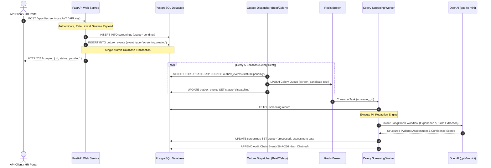

# System Architecture Overview

The **LangGraph Candidate Screening Service** is an enterprise-grade, asynchronous backend service built with Python 3.12, FastAPI, PostgreSQL, Redis, Celery, and LangGraph.

---

## Core System Architecture

---

## Key Architecture Components

### 1. Async FastAPI Front Door
- Fast HTTP ingestion layer handling payload validation, rate-limiting, and idempotency key checks.
- Returns immediate `202 Accepted` response with candidate screening ID.

### 2. Transactional Outbox Pattern
- Ensures atomic operations: candidate screening records and outbox event records are saved in the same PostgreSQL transaction.
- Eliminates dual-write anomalies (e.g. database save succeeds but message broker publish fails).

### 3. Redis Broker & Celery Workers
- Background task queues process long-running LLM workflow pipelines without blocking HTTP request threads.
- Celery Beat dispatches pending outbox events on a periodic schedule.

### 4. LangGraph Assessment Workflow
- Orchestrates multi-node LLM calls for structured experience categorization and skill matching.
- Enforces strict Pydantic output schemas, confidence scoring, and deterministic review routing.

### 5. Append-Only Hash-Chained Audit Log
- Maintains per-tenant SHA-256 tamper-evident event chains for regulatory compliance and audit readiness.

---

## Related Documents
- [LangGraph Pipeline Architecture](langgraph-pipeline.md)
- [Outbox & Worker Architecture](outbox-workers.md)
- [Audit Chain Architecture](audit-chain.md)
