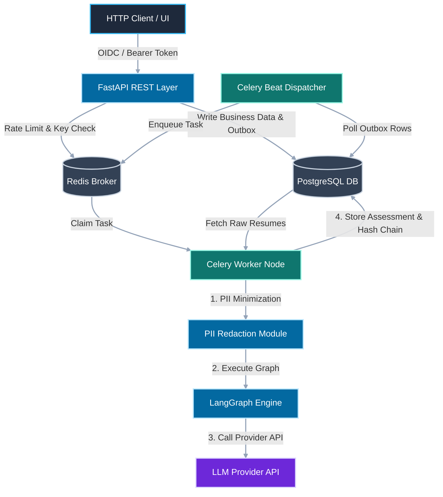

# LangGraph Candidate Screening Service

An asynchronous, enterprise-grade decision-support API that transforms resume evaluation into an auditable, evidence-focused workflow powered by **FastAPI**, **LangGraph**, **PostgreSQL**, **Redis**, and **OpenTelemetry**.

!!! warning "Mandatory AI Compliance Notice"
    **Human review is strictly required for all candidate evaluations.** This service never automatically rejects applicants, schedules interviews, or communicates hiring decisions. Outputs are purely advisory materials intended solely for qualified human reviewers.

---

## Technical Highlights

=== "LangGraph Workflows"
    * **Structured Evidence Extraction:** Evaluates candidate resumes against job descriptions to produce validated Pydantic structures (`ExperienceAssessment`, `SkillsAssessment`).
    * **Deterministic Routing:** Routes candidate submissions into specific review pathways (`hr_review`, `recruiter_review`, `manual_review`).

=== "Enterprise Security & Privacy"
    * **Pre-Provider PII Minimization:** Regex redaction masks emails, phone numbers, government IDs, and addresses before text reaches external LLMs.
    * **Tamper-Evident Audit Trail:** Per-tenant SHA-256 hash chains back all system events and human feedback records.
    * **OIDC & Granular RBAC:** Cryptographic JWT claim verification with fine-grained action scopes (`screening:write`, `review:appeal`, `audit:read`).

=== "Reliable Execution"
    * **Transactional Outbox Pattern:** Guarantees atomicity between business logic updates and Celery task dispatches, eliminating dual-write vulnerabilities.
    * **Submission Controls:** Redis Lua-scripted rate limiting and request fingerprinting prevent duplicate work.

---

## System Architecture


## Quickstart Shell Example

```bash
# 1. Clone the repository and configure environment variables
git clone https://github.com/organization/langgraph-candidate-screening.git
cd langgraph-candidate-screening
cp .env.example .env

# 2. Launch application services (FastAPI, Postgres, Redis, Celery)
docker compose up --build -d

# 3. Submit a candidate resume for processing
curl -X POST "http://localhost:8000/api/v1/screenings" \
  -H "Authorization: Bearer <JWT_TOKEN>" \
  -H "Content-Type: application/json" \
  -d '{
    "job_title": "Senior Python Engineer",
    "required_skills": ["Python", "FastAPI", "PostgreSQL", "AsyncIO"],
    "application_text": "5+ years developing async backend services in Python..."
  }'
```
`